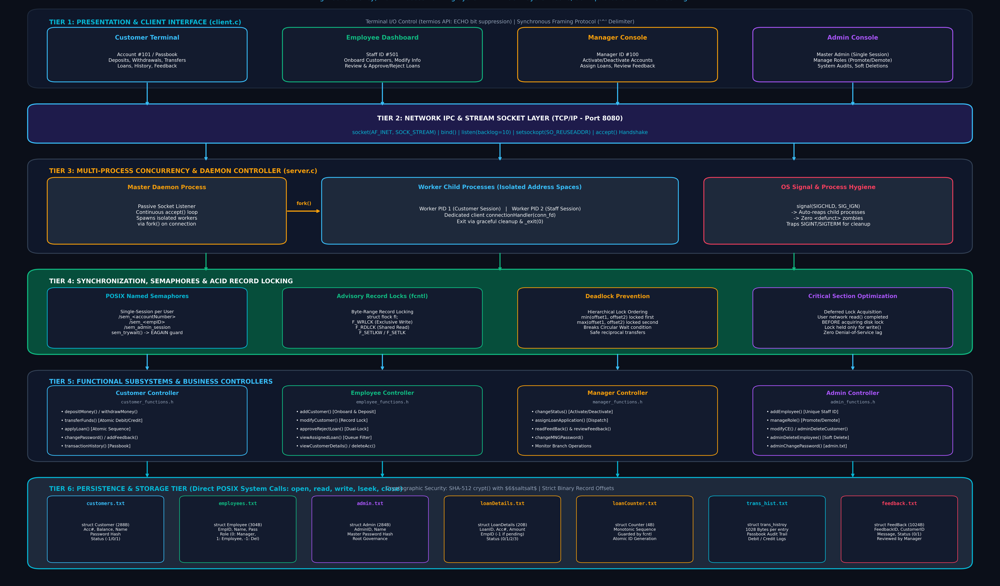
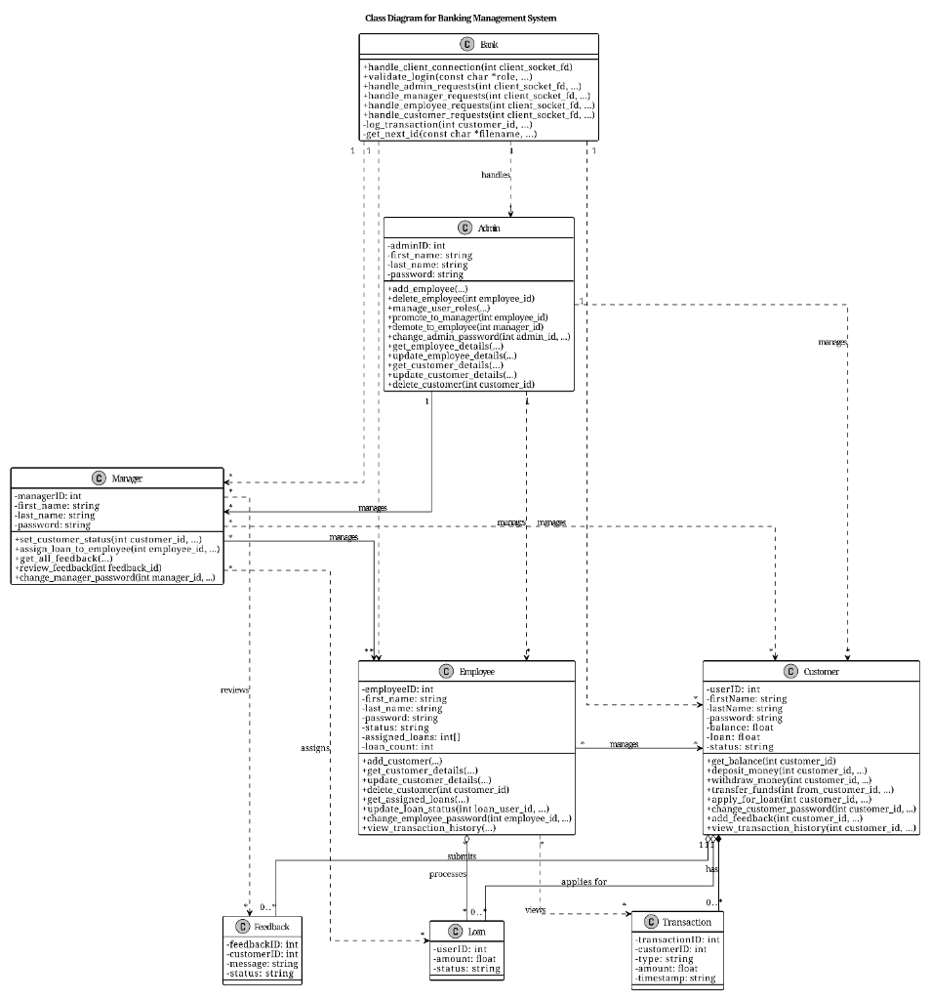

# Just Another Bank: High-Concurrency Banking Management System

> **CS-513: System Software – Mini Project**  
> **International Institute of Information Technology, Bangalore (IIIT-B)**  
> **System Name:** **Just Another Bank** *(Derived from the classical shield of protection—symbolizing security, synchronization, and data integrity)*

---

## 📌 Executive Summary

**Just Another Bank** is an enterprise-grade banking management simulation built from the ground up in **C** using **low-level POSIX system calls**. It models the core operational and administrative lifecycle of a financial institution—encompassing multi-client concurrency, role-based access control (RBAC), inter-account fund transfers, loan application pipelines, transaction audit trails, and feedback moderation.

The central focus of Just Another Bank is **robust system programming**: ensuring strict **ACID transaction guarantees**, eliminating race conditions, preventing deadlocks, managing operating system process lifecycles, and enforcing single-session authentication via POSIX kernel synchronization primitives.

---

## 🏛️ System Architecture & Class Blueprint

AegisBank is designed around a 6-tier architecture that isolates client sessions, ensures concurrency safety, and enforces strict ACID transaction guarantees across all banking operations.

### 1. High-Level System Architecture
Below is the complete single-image architectural visualization depicting all 6 tiers—from presentation, socket networking, daemon process management, synchronization, and functional controllers down to direct POSIX disk persistence:



---

### 2. UML Class Diagram & Entity Relationships
Below is the class diagram showing the object-oriented structure, method signatures, attributes, and associations implemented across the subsystems:



### Architectural Entity Breakdown
* **`Bank` (Daemon / Server)**: Manages socket binding, connection acceptance, worker process spawning (`fork()`), signal trapping, and global request dispatching.
* **`Admin` (Governance)**: Highest privilege level. Governs employee onboarding, role promotions/demotions, customer and staff account deletions, system audits, and master password management.
* **`Manager` (Operations)**: Oversees branch operations, activates/deactivates customer accounts, delegates pending loan applications to employees, and reviews customer feedback.
* **`Employee` (Staff / Teller)**: Registers new customers, updates account details, processes assigned loan applications (Approve / Reject), and audits customer passbooks.
* **`Customer` (Account Holder)**: Views real-time balance, deposits funds, withdraws cash, executes inter-account transfers, applies for loans, reviews transaction history, and submits feedback.
* **`Loan`, `Feedback`, `Transaction`**: Binary persistent data structures stored on disk, maintaining relational consistency across customer and staff workflows.

---

## ⚙️ Core System Programming & C Concepts Implemented

AegisBank intentionally replaces high-level library abstractions with direct **UNIX / POSIX system calls** to demonstrate fundamental operating system and systems programming concepts:

### 1. Multi-Process Concurrency & Worker Lifecycle (`fork`)
* **Concurrent Server Architecture**: When a client connects via `accept()`, the parent server daemon immediately spawns a dedicated worker process using `fork()`.
* **Process Address Space Isolation**: Each client session executes in its own distinct virtual address space. If a client worker process encounters an error or disconnects, the parent daemon and other client sessions remain entirely unaffected.
* **Zombie Process Prevention (`SIGCHLD`)**: The server registers `signal(SIGCHLD, SIG_IGN)`. This instructs the Linux kernel to immediately reap terminating child processes and deallocate their process table slots without requiring blocking `wait()` or `waitpid()` calls, eliminating `<defunct>` zombie processes.

### 2. Network IPC & Socket Programming
* **Stream Sockets (`SOCK_STREAM`)**: Communication runs over TCP/IP sockets (`AF_INET`, port `8080`) providing reliable, ordered, full-duplex byte streams.
* **Address Reuse (`SO_REUSEADDR`)**: Configured using `setsockopt()` to allow instant server restarts without waiting for the TCP `TIME_WAIT` socket timeout.
* **Custom Synchronization Protocol**:
  * Fixed-length **4096-byte buffers** prevent partial packet fragmentation.
  * Caret (`^`) delimited framing signals alerts/notifications to the client, prompting the client to strip the delimiter, render the message, and send back a synchronous acknowledgement frame (`""`) to keep both state machines in lockstep.

### 3. POSIX Terminal I/O Control (`termios`)
* **Echo Suppression during Password Input**: Sensitive inputs (passwords, credential updates) trigger `hide_input()` in `client.c`.
* Uses `tcgetattr()` and `tcsetattr()` to clear the `ECHO` bit in `c_lflag`. Terminal echo is disabled during typing and restored immediately afterward, preventing visual credential leakage.

### 4. Process Synchronization & Single-Session Enforcement (POSIX Semaphores)
* **Single Active Session Guarantee**: A customer, employee, manager, or administrator can only be logged in from **one terminal at a time**.
* **Binary Named Semaphores (`sem_open`, `sem_trywait`, `sem_post`, `sem_unlink`)**:
  * Each entity is bound to a unique named semaphore in `/dev/shm`:
    * Customer: `/sem_<accountNumber>`
    * Employee: `/sem_<empID>`
    * Manager: `/sem_<mngID>`
    * Administrator: `/sem_admin_session`
  * Login attempts utilize `sem_trywait()`. If the semaphore is already held (count 0), it fails with `EAGAIN`, immediately rejecting concurrent logins with an alert message.
  * On logout or graceful exit, `sem_post()`, `sem_close()`, and `sem_unlink()` release the kernel primitive.
* **Crash-Resilient Signal Trapping**: Signal handlers for `SIGINT`, `SIGTERM`, `SIGSEGV`, `SIGHUP`, and `SIGQUIT` ensure active semaphores are unlinked if the process is terminated prematurely, preventing permanent lockouts.

### 5. Advisory Record-Level File Locking (`fcntl`)
* **Granular Byte-Range Locking**: Rather than locking an entire database file (which would serialize the entire bank), AegisBank uses `fcntl()` with `struct flock` to lock **individual struct records** at exact byte offsets computed via `lseek()`.
* **Lock Types**:
  * `F_WRLCK` (Exclusive Write Lock): Applied during deposits, withdrawals, transfers, loan evaluations, and role updates. Blocks concurrent readers and writers on that specific record.
  * `F_RDLCK` (Shared Read Lock): Allows concurrent inspection while preventing simultaneous writes.
  * `F_SETLKW` (Blocking) / `F_SETLK` (Non-blocking): Used to wait for record availability or release locks (`F_UNLCK`).
* **Critical Section Duration Minimization**: User network socket I/O is performed **before** acquiring disk file locks. This guarantees that file locks are held only for the microsecond duration of the disk computation and write, completely preventing denial-of-service from idle or lagging clients.

### 6. ACID Transaction Guarantees in Banking
* **Atomicity**: In `transferFunds()`, funds deducted from the source account and credited to the destination account occur as an indivisible unit of work. If validation fails, both accounts remain unmodified.
* **Consistency**: Balance invariants ensure an account balance never drops below zero (`customer.balance >= withdrawAmount`). Status validations ensure inactive or deleted accounts cannot transact.
* **Isolation**: Record-level write locks prevent dirty reads, non-repeatable reads, and lost updates during concurrent operations.
* **Durability**: System calls (`write()`, `lseek()`) directly commit changes to persistent disk files (`customers.txt`, `employees.txt`, `trans_hist.txt`).

### 7. Deadlock Prevention (Hierarchical Lock Acquisition)
* **The Problem**: If Customer A transfers funds to Customer B while Customer B concurrently transfers funds to Customer A, a standard locking strategy causes a circular wait deadlock: Process 1 locks A and waits for B, while Process 2 locks B and waits for A.
* **The Solution**: AegisBank strictly eliminates Coffman's circular wait condition by enforcing **canonical lock ordering**:
  $$\text{First Locked} = \min(\text{srcOffset}, \text{dstOffset})$$
  $$\text{Second Locked} = \max(\text{srcOffset}, \text{dstOffset})$$
  Both processes request the records in the exact same sequential order, making deadlocks mathematically impossible.

### 8. Cryptographic Password Security (`crypt`)
* Passwords are never stored in plaintext.
* Standard POSIX SHA-512 one-way hashing is applied via `crypt(password, "$6$saltsalt$")` before persisting to disk. Verification compares the freshly hashed user input against the stored digest.

---

## 🗂️ Persistent Data Files & Storage Layout

All data is managed in binary records using fixed-size C structs, ensuring exact record offset calculations via `sizeof()`:

| File Name | Record Structure | Size per Record | Description |
| :--- | :--- | :---: | :--- |
| `customers.txt` | `struct Customer` | 288 bytes | Stores account number, balance, customer name, password hash, and active status (`-1`: Deleted, `0`: Inactive, `1`: Active). |
| `employees.txt` | `struct Employee` | 304 bytes | Stores staff ID, first name, last name, password hash, and role (`-1`: Deleted, `0`: Manager, `1`: Employee). |
| `admin.txt` | `struct Admin` | 284 bytes | Persistent credentials for system administrator. |
| `loanDetails.txt` | `struct LoanDetails` | 20 bytes | Tracks loan ID, account number, principal amount, assigned employee ID, and state (`Requested`, `Pending`, `Approved`, `Rejected`). |
| `loanCounter.txt` | `struct Counter` | 4 bytes | Monotonically increasing atomic sequence generator for unique Loan IDs (guarded by `fcntl` write locks). |
| `trans_hist.txt` | `struct trans_histroy` | 1028 bytes | Transaction audit trail recording debits, credits, transfers, and timestamps. |
| `feedback.txt` | `struct FeedBack` | 1024 bytes | Stores feedback ID, customer ID, message text, and review status (`Pending`, `Reviewed`). |

---

## 👥 Role-Based Functionality Matrix

### 1. 👤 Customer Subsystem (`customer_functions.h`)
* **Account Balance**: Real-time read of account liquidity.
* **Deposit Money**: Credits funds, updates balance with record locking, and appends to audit passbook.
* **Withdraw Money**: Enforces balance constraints, debits account under record lock, and updates audit passbook.
* **Transfer Funds**: Inter-account transfer featuring deadlock-free ordered locking and atomic balance updates.
* **Apply for Loan**: Requests a loan principal; allocates atomic sequence ID via synchronized counter lock.
* **Change Password**: Updates password hash using SHA-512 `crypt()`.
* **Customer Feedback**: Submits categorized feedback linked to customer ID with `Pending` status.
* **Transaction History**: Displays the last 10 transactions with exact system timestamps.
* **Logout & Exit**: Releases session semaphore, disconnects socket, and terminates process cleanly.

### 2. 👔 Bank Employee Subsystem (`employee_functions.h`)
* **Add New Customer**: Onboards new customer, validates account number uniqueness, records initial deposit, and generates audit log.
* **Edit Customer Info**: Modifies account holder profile details with record write locks.
* **Review / Process Loans**: Multi-file atomic transaction: validates customer active status, marks loan `Approved` or `Rejected`, and auto-credits approved principal to customer balance.
* **View Assigned Loan Tasks**: Filtered view displaying only pending loans allocated to the logged-in employee ID.
* **Passbook Audit**: Allows staff to view transaction history for any customer account.
* **View Customer Details**: Read-only attribute inspection under shared lock.
* **Delete Customer Account**: Soft-deletes customer account (`activeStatus = -1`).
* **Change Password**: Updates employee password hash.

### 3. 💼 Bank Manager Subsystem (`manager_functions.h`)
* **Activate / Deactivate Accounts**: Suspends or reactivates customer accounts under `fcntl` write lock. Inactive accounts are blocked from logging in or receiving loan approvals.
* **Assign Loan Applications**: Displays all unassigned loan requests (`empID == -1`, `status == Requested`) and delegates them to an active employee for review.
* **Feedback Moderation**: Displays customer feedback entries; allows manager to review and mark items as `Reviewed` (`review_feedback`).
* **Change Password**: Updates manager password hash.

### 4. 🔑 Administrator Subsystem (`admin_functions.h`)
* **Single-Session Admin Control**: Protected by `/sem_admin_session` named semaphore.
* **Register Bank Employee**: Creates staff members with unique IDs, hashed credentials, and default role `1` (Employee).
* **Manage Roles & Permissions**: Dynamically promotes an employee to Manager (`role = 0`) or demotes a manager to Employee (`role = 1`).
* **Modify Customer / Employee Details**: Updates customer or staff information.
* **System-Wide Deletions**: Soft-deletes staff (`role = -1`) or customer accounts (`activeStatus = -1`).
* **Change Admin Password**: Updates root master password persistently in `admin.txt`.

---

## 🚀 Compilation & Execution Guide

### Prerequisites
A Linux environment (Ubuntu / Debian / WSL / POSIX-compliant UNIX) with `gcc`, `make`, and standard C development libraries.

### 1. Compile the Server Daemon
Compile with `-lcrypt` (for SHA-512 password hashing) and `-lpthread` (for POSIX named semaphores):
```bash
gcc server.c -o server -lcrypt -lpthread
```

### 2. Compile the Client Application
```bash
gcc client.c -o client
```

### 3. Run the Server
Launch the server in a dedicated terminal window or in the background:
```bash
./server
```
*Console output:*
```text
[SERVER] Socket created successfully (fd: 3)
[SERVER] Binding successful to port 8080
[SERVER] Server listening for concurrent incoming client connections...
```

### 4. Launch Client Terminal(s)
Open one or more terminal windows and connect to the server:
```bash
./client
```

---

## 🔑 Default Login Credentials

| Role | Identifier / Username | Default Password | Menu Option |
| :--- | :---: | :---: | :---: |
| **Administrator** | Root Admin | **`admin@123`** | Option `4` |
| **Manager** | Manager ID **`100`** or **`500`** | **`password`** | Option `3` |
| **Employee** | Staff ID **`501`** or **`503`** | **`password`** | Option `2` |
| **Customer** | Account **`101`** (Vikas) | **`password`** | Option `1` |
| **Customer** | Account **`103`** (Mohit) | **`password`** | Option `1` |
| **Customer** | Account **`1003`** (Lakshman) | **`1003`** | Option `1` |

---

## 🧪 Verification & Demonstration Scenarios

For evaluations and lab demonstrations, perform the following verification tests:

1. **Deadlock-Free Concurrent Transfer**:
   * Open two terminals: Terminal 1 logged into Account `101`, Terminal 2 logged into Account `103`.
   * Simultaneously trigger reciprocal transfers (101 $\rightarrow$ 103 and 103 $\rightarrow$ 101).
   * Both transactions succeed with correct final balances without deadlock.
2. **Duplicate Login Prevention**:
   * Log into Customer `101` in Terminal 1.
   * Attempt to log into Customer `101` in Terminal 2 $\rightarrow$ Access is rejected with `"User is already logged in on another session!"`.
3. **Zombie Process Elimination Check**:
   * Connect and disconnect several client terminals.
   * Run `ps -ef | grep defunct` in Linux. Verified output: **0 zombie processes**.
4. **Semaphore Clean-Up Verification**:
   * While logged in, verify semaphore creation: `ls -l /dev/shm`.
   * Upon logout, verify semaphore deletion: `ls -l /dev/shm` (semaphore unlinked).
5. **Loan Approval Workflow**:
   * Customer `101` applies for a loan $\rightarrow$ Manager `100` assigns it to Employee `501` $\rightarrow$ Employee `501` approves it $\rightarrow$ Customer `101` balance automatically credited with principal.

---

## 👥 Authors & Academic Context

* **Project**: Design and Development of Banking Management System
* **Course**: CS-513 System Software (Mini Project)
* **Institution**: International Institute of Information Technology, Bangalore (IIIT-B)
